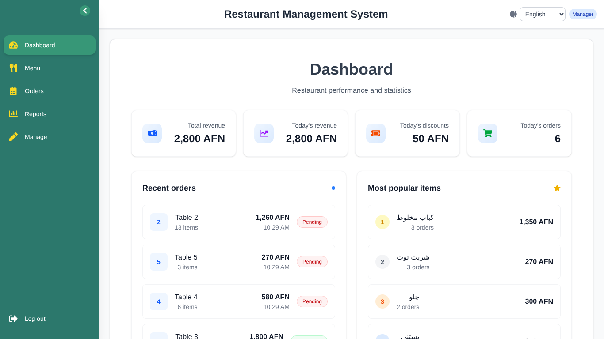
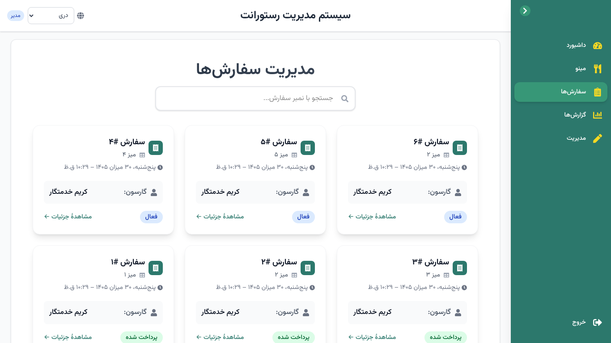
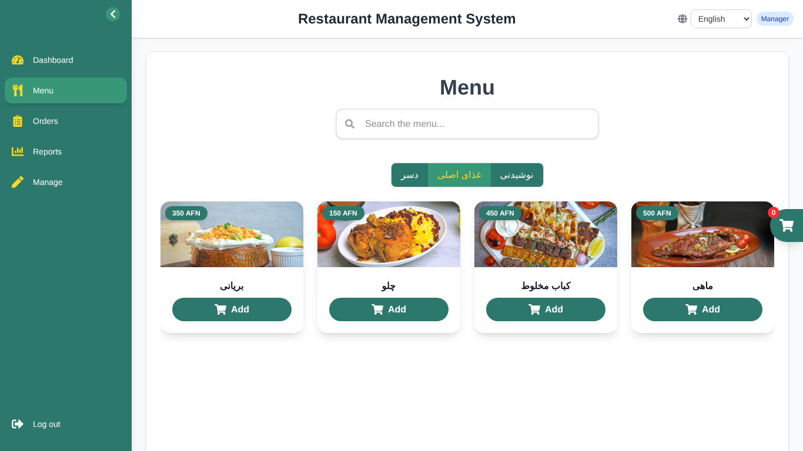
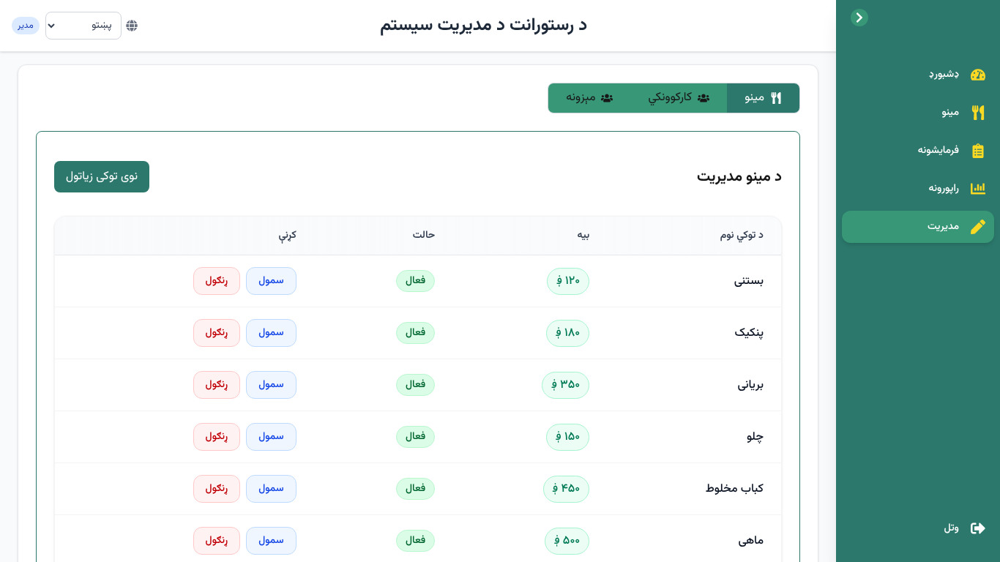
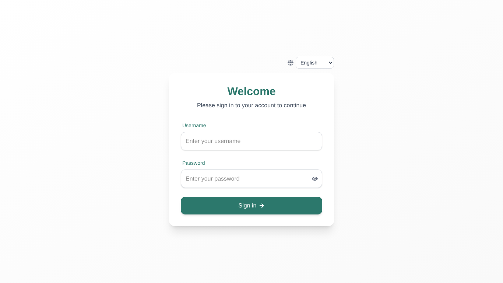
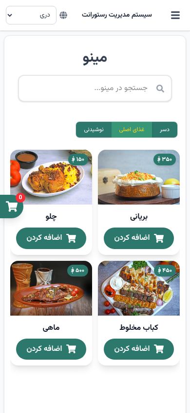
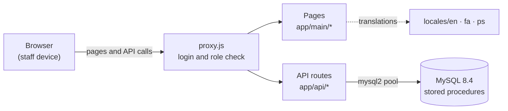

<div align="center">

# 🍽️ RMS — Restaurant Management System

**Orders by table · kitchen tickets · payments and bills · menu, staff and tables · sales reports**

Trilingual (**English · دری · پښتو**) · fully **offline** · role-based access


</div>

<p align="center">
  
  
</p>

---

## Contents

- [Features](#features)
- [Screenshots](#screenshots)
- [Roles and permissions](#roles-and-permissions)
- [Tech stack and architecture](#tech-stack-and-architecture)
- [Getting started](#getting-started)
- [Configuration](#configuration)
- [Everyday commands](#everyday-commands)
- [Languages](#languages)
- [Offline use and fonts](#offline-use-and-fonts)
- [Database](#database)
- [Backup and restore](#backup-and-restore)
- [Testing](#testing)
- [Security](#security)
- [Project structure](#project-structure)
- [Before going to production](#before-going-to-production)
- [License](#license)
- [Credits](#credits)

## Features

| | |
|---|---|
| 🧾 **Ordering** | Browse the menu by category, add to a cart, place an order for a table or add items to an open order |
| 👨‍🍳 **Kitchen** | A kitchen ticket prints automatically for new orders; items move from *pending* to *in progress* |
| 💵 **Payment** | Discounts, confirmation, printed customer bill; totals are always recalculated by the database |
| 💾 **Backups** | Manage → Backups: back up now, automatic schedule (daily / twice a day / weekly), download; verified backups of the database and pictures; safe restore |
| 🔒 **Safe saving** | An order and its items are saved together in one database transaction — never half-saved |
| 📊 **Dashboard** | Total and today's revenue, discounts, orders, recent orders and the most popular items |
| 📈 **Reports** | Sales, financial, orders and products reports for any date range, printable |
| 🛠️ **Management** | Menu items with pictures, categories, staff accounts and roles, tables (active/inactive) |
| 🌐 **Three languages** | English (default), Dari and Pashto, with right-to-left layout, Afghan solar calendar and ۱۲۳ digits |
| 📴 **Offline** | Runs on a local network with no internet: all fonts and assets are part of the project |
| 📱 **Responsive** | Phone, tablet and desktop layouts |

## Screenshots

| Menu (English) | Menu management (Pashto) |
|---|---|
|  |  |

| Sign-in | Phone (Dari) |
|---|---|
|  |  |

## Roles and permissions

| Area | Manager | Cashier | Waiter | Chef |
|---|:---:|:---:|:---:|:---:|
| Menu and placing orders | ✅ | ✅ | ✅ | ✅ |
| Orders list and details | all | all | own orders only | all |
| Send items to the kitchen | ✅ | ✅ | own orders | ✅ |
| Cancel an open order | ✅ | ✅ | own orders | ❌ |
| Payment and customer bill | ✅ | ✅ | ❌ | ❌ |
| Dashboard and reports | ✅ | ❌ | ❌ | ❌ |
| Manage menu, staff and tables | ✅ | ❌ | ❌ | ❌ |

Every page and API request checks the account in the database, so deactivating a user or changing
a role takes effect immediately.

## Tech stack and architecture

| Layer | Technology |
|---|---|
| Front end | Next.js 16 (App Router), React 19, Tailwind CSS 4, Framer Motion, React Hot Toast |
| Back end | Next.js route handlers (`app/api`), JWT session cookie, bcrypt password hashes |
| Database | MySQL 8.4 with stored procedures, run in Docker |
| i18n | Own lightweight layer: JSON dictionaries, `Intl` number formats, `jalaali-js` for the solar calendar |



## Getting started

**Requirements:** Node.js 20.9+ LTS, Git, and Docker Desktop (running). Internet is needed only once,
to download the code and the npm packages.

```bash
# 1. Get the code and install the packages
git clone https://github.com/Akhlaqi-Hussain/RMS.git
cd RMS
npm ci        # slow connection: npm ci --fetch-timeout=600000 --fetch-retries=6

# 2. Create your private settings (see "Configuration") from the template
copy .env.example .env.local        # macOS/Linux: cp .env.example .env.local

# 3. Start the database (the first start creates rms_dev and rms_test with sample data)
docker compose --env-file .env.local up -d
docker compose --env-file .env.local ps     # wait for "healthy"

# 4. Start the app, then open http://localhost:3000
npm run dev
```

**Sample accounts** (development and test data only — never use them on a real installation):
`manager1`, `cashier1`, `waiter1`, `chef1`, all with the password `DevOnly@123`.

## Configuration

`.env.local` is private and is never committed. Replace every placeholder with your own strong value.

| Variable | Example | Meaning |
|---|---|---|
| `DB_HOST` | `127.0.0.1` | Database server |
| `DB_PORT` | `3307` | Port of the Docker database (3306 is often used by XAMPP) |
| `DB_USER` | `rms_app` | Limited database user used by the app |
| `DB_PASSWORD` | — | Password of `rms_app` |
| `DB_NAME` | `rms_dev` | `rms_dev` for daily use, `rms_test` for automated tests, `rms_prod` for real use |
| `JWT_SECRET` | — | Long random string used to sign login cookies |
| `MYSQL_ROOT_PASSWORD` | — | Root password of the Docker database |
| `COOKIE_SECURE` | `false` | Optional. Only for `npm start` on a trusted local network reached over plain `http://` (phones, other PCs); see [`docs/GOING-LIVE.md`](docs/GOING-LIVE.md) |
| `BACKUP_DB_USER`, `BACKUP_DB_PASSWORD` | `rms_backup` | Optional, with `BACKUP_MODE=direct`: backups use this read-only database user instead of root; see [`docs/PACKAGING.md`](docs/PACKAGING.md) |
| `RMS_DATA_DIR` | `C:\ProgramData\RMS` | Installed RMS only (set by the service, not in this file): settings, pictures, backups and logs all in that folder; see [`docs/PACKAGING.md`](docs/PACKAGING.md) |

## Everyday commands

| Task | Command |
|---|---|
| Start the database | `docker compose --env-file .env.local up -d` |
| Start the app (development) | `npm run dev` |
| Lint | `npm run lint` |
| API regression test (app running on `rms_test`) | `npm run test:api` |
| Back up now / restore the newest backup | `npm run backup` / `npm run restore -- --latest` |
| Production build and start | `npm run build` then `npm start` |
| New empty production database / first manager | `npm run db:setup-prod` / `npm run create-manager -- --db rms_prod` |
| Client package without source code (checked) | `npm run package` — see [`docs/PACKAGING.md`](docs/PACKAGING.md) |
| Stop the database (data is kept) | `docker compose --env-file .env.local stop` |

Backup, restore and a full reset are described in [`database/README.md`](database/README.md).

## Languages

Choose **English**, **دری** or **پښتو** from the switcher at the top. The choice is stored in the
`lang` cookie, and addresses do not change.

| | English | Dari | Pashto |
|---|---|---|---|
| Direction | left-to-right | right-to-left | right-to-left |
| Date | Wed, 21 Oct 2026 | چهارشنبه، ۲۹ میزان ۱۴۰۵ | شورو، ۲۹ تله ۱۴۰۵ |
| Money | 1,250 AFN | ۱٬۲۵۰ ؋ | ۱٬۲۵۰ ؋ |

- Texts are in `locales/en/common.json`, `locales/fa/common.json` and `locales/ps/common.json`;
  keep the same keys in all three files.
- Server and database messages are translated on screen (`lib/i18n/serverMessages.js`).
- The restaurant name, address and phone printed on bills are under `restaurant` in each file;
  the bill number prefix is in `utils/restaurantInfo.js`.
- Data entered by users (menu items, categories, names) is shown as typed.

## Offline use and fonts

Once installed, RMS needs **no internet connection** — not to run and not to build. Nothing is
loaded from other websites.

| Used for | Font | Files |
|---|---|---|
| Dari and Pashto screens, bills and reports | **Vazirmatn** (Vazir), then **Noto Sans Arabic** (also draws ؋), then Tahoma / Segoe UI | `public/fonts/` |
| Tailwind `font-sans` / `font-mono` | Geist, Geist Mono | `app/fonts/` |
| English screens | Arial / Helvetica (installed on every computer) | — |

All bundled fonts are free under the SIL Open Font License; the licence texts are next to the files.

## Database

MySQL 8.4 runs in Docker on `127.0.0.1:3307`, reachable only from the same computer.

- `database/migrations/` — tables and stored procedures (additive; never drops tables)
- `database/seeds/dev_seed.sql` — sample data for development and tests only
- `database/docker-init/01-init.sh` — runs once on first start: creates `rms_dev`, `rms_test` and
  the limited user `rms_app` (no right to create or drop tables)

Prices and bill totals are always taken from the database, never from the browser.

## Backup and restore

Every backup is **one file** that contains the whole database (tables, data, stored procedures),
all menu pictures and a manifest with a checksum for every file and the row count of every table.
Each backup is read back and checked right after it is made.

```text
rms-backups/
  rms-backup_rms_dev_2026-11-01_233000_monthly.tar.gz
  rms-backup_rms_dev_2026-10-31_233000_weekly.tar.gz
  rms-backup_rms_dev_2026-10-30_233000_daily.tar.gz
  backup.log
```

| Task | Command |
|---|---|
| Back up now | `npm run backup` |
| List backups | `npm run backup:list` |
| Check that a backup file is complete | `npm run backup:verify -- <file>` |
| Restore the newest backup | `npm run restore -- --latest` |
| Restore a specific file (e.g. from a USB disk) | `npm run restore -- E:\RMS-backups\<file>` |

**In the app: Manage → Backups** (managers only)

- **Back up now** button.
- **Automatic backups**: on/off, *every day*, *twice a day* or *once a week*, at a chosen time
  (default: every day at 23:30). Saved in `backup-settings.json` in the backup folder.
  The schedule runs inside RMS while it is running; if the computer was off at the planned time,
  the backup is made about two minutes after RMS starts. A failed attempt is retried after 10 minutes.
- **List of backups** with **Download** (e.g. to save a copy on a USB disk).
- Restoring is intentionally not a button — see below.

**Optional: Windows scheduled task** (makes backups even when RMS itself is not running):

```bat
powershell -ExecutionPolicy Bypass -File scripts\windows\schedule-backup.ps1
```

This creates the task **RMS Backup** (every night at 23:30; runs later if the PC was off; retries if
Docker is not ready). Use `-Time 22:00` for another time or `-Remove` to delete it. Both schedules can be
used together; if they start at exactly the same moment you may get one extra copy, which is harmless.
To use only the Windows task, set `BACKUP_SCHEDULER=off` in `.env.local`.

**What is kept** (grandfather-father-son rotation, about one year of history in ~24 files):

| Kind | When | Kept |
|---|---|---|
| Monthly | first backup of each month | 12 |
| Weekly | first backup of each week (Saturday) | 5 |
| Daily | every other night | 7 |
| Manual | `npm run backup` | 10 |
| Before restore | made automatically by every restore | 5 |

Only files with this exact naming pattern are ever deleted; anything else in the folder is left alone.

**Restoring safely.** Stop the app, then run `npm run restore -- --latest` (or name a file). The restore:

1. checks the backup file (checksums, complete dump);
2. asks you to type the database name to confirm;
3. makes a **safety backup of the current data first**, so a restore can always be undone;
4. replaces the database, and the menu pictures if it is the database RMS uses (`DB_NAME`). Restoring another database (for example a practice restore into `rms_test`) keeps the existing pictures and only adds missing ones; `--with-pictures` forces a full replace;
5. compares the row count of every table with the backup.

**Recommended practice (3-2-1):** keep backups in at least two places. Set
`BACKUP_COPY_DIR` in `.env.local` (for example `E:\RMS-backups` on a USB disk or a second drive)
and every backup is copied there automatically. Once a month, practise a restore by loading your
newest backup into the test database: `npm run restore -- <newest backup file> --db rms_test`
(`--latest` always picks the newest backup *of the database being restored*).

The dashboard and Manage → Backups show when the last backup was made and warn if there has been
none for more than a day.

**Full recovery on a new PC:** install the requirements, `git clone` and `npm ci`, create a new
`.env.local`, start the database (`docker compose --env-file .env.local up -d`), copy the backup file
to the PC, then run `npm run restore -- <file>`.

## Testing

The API regression test in [`tests/api/rms-api-test.mjs`](tests/api/rms-api-test.mjs) checks login,
roles, menu, tables, staff, orders (including all-or-nothing saving), kitchen, payment, dashboard,
reports, upload safety, the backup screen and the security rules of Round 7 — **177 checks**
(178 when the test is started with `RMS_DATA_DIR`). One check makes a small manual backup
of the test database. It needs no extra packages.

1. Window A: `set DB_NAME=rms_test` (macOS/Linux: `export DB_NAME=rms_test`), then `npm start`.
2. Window B, in the project folder: `npm run test:api` → expect `FAIL=0`.
3. **Close window A afterwards**, because the `DB_NAME` setting lasts for the whole window.

The test creates its own uniquely named records and only reads the sample data, so it can be
run many times. Never point it at a real (production) database.

> `rms_dev` and `rms_test` share the picture folder `public/uploads/menu`: deleting a sample menu
> item in either database also deletes its picture for the other.

## Security

- Passwords are stored as bcrypt hashes; login uses an HTTP-only, SameSite=Lax cookie (secure in production unless `COOKIE_SECURE=false` for a trusted local network).
- Login and role checks on every page and API route; deactivated accounts are refused immediately.
- Uploaded pictures are checked by their real content (JPEG/PNG/WEBP, max 5 MB) and renamed.
- Database errors are never shown to users; friendly messages only.
- The database port is bound to `127.0.0.1`.
- Production dependencies: `npm audit --omit=dev` reports no known vulnerabilities (Next.js 16.3).

## Project structure

```text
app/            pages (app/main/...), API routes (app/api/...), layout, global styles, fonts
components/     sidebar, cart, language switcher, cards, tables
context/        cart and language state
lib/            database pool, session checks, upload checks, i18n helpers
locales/        en · fa (Dari) · ps (Pashto) dictionaries
schemas/        form validation (zod)
utils/          bill and report printing
database/       migrations, seed data, Docker init script
public/         bundled fonts and uploaded menu pictures
docs/           going-live guide, backup copy, real-device checklist, screenshots
tests/api/      API regression test (npm run test:api)
scripts/        backup, restore, production setup, first manager, Windows schedule and autostart
proxy.js        page and API protection (called middleware.js before Next.js 16)
```

## Before going to production

Step-by-step guide: [`docs/GOING-LIVE.md`](docs/GOING-LIVE.md). Going live is the owner's decision; nothing runs by itself.

| Step | Tool |
|---|---|
| A separate, **empty** database `rms_prod` (no sample data; never touches an existing database) | `npm run db:setup-prod` |
| The first manager account (hidden password, bcrypt) | `npm run create-manager -- --db rms_prod` |
| Second backup copy on a USB disk or second drive | [`docs/BACKUP-COPY.md`](docs/BACKUP-COPY.md) |
| Optional: start RMS when Windows signs in | `scripts\windows\autostart-rms.ps1` |
| Real-device checks (receipt printer, iPhone/Android, offline) | [`docs/TEST-CHECKLIST.md`](docs/TEST-CHECKLIST.md) |

Use HTTPS, or a trusted local network only.

## License

Proprietary — **all rights reserved**. See [`LICENSE`](LICENSE). The bundled fonts keep their own
SIL Open Font License.

## Credits

Original project by **[Akhlaqi-Hussain](https://github.com/Akhlaqi-Hussain)**.
Database integration, security hardening, translations and offline support by
**[Habibullah Farahmand](https://github.com/HabibullahFarahmand)**.

Fonts: [Vazirmatn](https://github.com/rastikerdar/vazirmatn) ·
[Noto Sans Arabic](https://github.com/notofonts/arabic) ·
[Geist](https://github.com/vercel/geist-font) — all under the SIL Open Font License 1.1.
